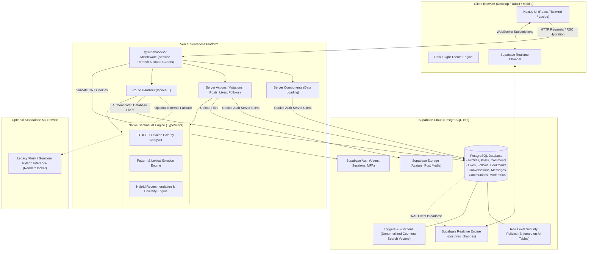

# SocialSentinel: Production Target Architecture Specification

**Status:** Approved Target Architecture  
**Platform:** Next.js App Router (TypeScript) + Supabase PostgreSQL  
**Deployment Target:** Vercel (Edge / Serverless) + Supabase Cloud  

---

## 1. Architectural Philosophy: The Modular Monolith

SocialSentinel is designed as a **Modular Monolith** rather than a distributed set of microservices. This provides maximum developer velocity, type safety across client and server boundaries, atomic database transactions, zero network latency between business modules, and simplified operations on modern cloud infrastructure (Vercel and Supabase).

### Core Principles
1. **Zero External API Costs or Runtimes:** Core social, sentiment analysis, and recommendation features run completely without OpenAI keys, third-party inference endpoints, or paid rate limits.
2. **Security by Default:** Database-enforced Row Level Security (RLS) ensures that even if an application bug occurs, unauthorized data access or mutations are impossible at the database engine level.
3. **Optimistic & Responsive UX:** Server Components deliver initial HTML fast without layout shift; Server Actions and Client Components provide optimistic updates with instant feedback.
4. **Explainable AI:** Recommendations and sentiment analyses are never "black boxes"; users receive transparent match percentages and human-readable badges derived from actual signal weights.

---

## 2. Technology Stack

| Layer | Technology | Version | Rationale |
| :--- | :--- | :--- | :--- |
| **Framework** | Next.js (App Router) | 14+ / 15 | Native React Server Components, Route Handlers, Server Actions, edge-friendly routing. |
| **Language** | TypeScript | 5+ | Strict type checking (`strict: true`) across models, database entities, and UI state. |
| **Styling** | Tailwind CSS + CSS Variables | 3.4+ | Utility-first styling paired with CSS custom properties for instant dark/light theme switching. |
| **Icons** | Lucide React | Latest | Clean, accessible icon system with low bundle footprint. |
| **Database** | Supabase PostgreSQL | 15+ | Relational integrity, foreign keys, triggers, JSONB support, and PostgreSQL RLS. |
| **Authentication** | Supabase Auth + `@supabase/ssr` | Latest | Secure HTTP-only cookies, PKCE exchange, server-side session verification, no localStorage tokens. |
| **File Storage** | Supabase Storage | S3-compatible | Public avatar and post media buckets with file size/type constraints and RLS access rules. |
| **Realtime** | Supabase Realtime (WebSockets) | Integrated | Live updates for direct messages and notifications without polling. |
| **Validation** | Zod | 3+ | Runtime schema validation for all API inputs, forms, and environment variables. |
| **Testing** | Vitest + React Testing Library | Latest | Blazing-fast unit, algorithm, and component test suite with standard ESM support. |

---

## 3. High-Level System Architecture Diagram



---

## 4. Modular Directory & Domain Structure

The application business logic is organized into clean, domain-specific modules under `src/`:

```
src/
├── app/                             # Next.js App Router Pages & Layouts
│   ├── (auth)/                      # Authentication routes (login, register, forgot-password)
│   ├── (main)/                      # Protected app shell with Left Sidebar Rail
│   │   ├── feed/                    # Home feed (Personalized, Following, Latest)
│   │   ├── explore/                 # Explore & trending topic discovery
│   │   ├── messages/                # One-to-one direct conversations
│   │   ├── communities/             # Topic communities & feeds
│   │   ├── ai-studio/               # Sentinel AI Studio (NLP sentiment inspector & metrics)
│   │   ├── community-pulse/         # Community health & aggregate discussion insights
│   │   ├── settings/                # User profile, privacy & healthy-feed controls
│   │   └── [username]/              # User profile pages
│   ├── api/                         # Route handlers for public/integrations
│   │   ├── health/                  # Health & readiness checks
│   │   ├── sentiment/               # Sentiment prediction endpoint
│   │   └── recommendations/         # Explainable recommendation feed API
│   ├── layout.tsx                   # Root layout with theme provider & metadata
│   └── page.tsx                     # Landing / entry redirect
│
├── modules/                         # Core Business Logic Modules
│   ├── auth/                        # Session management, guards, user retrieval
│   ├── profiles/                    # Profile data, avatars, bio, privacy settings
│   ├── posts/                       # Post CRUD, validation, media attachments, ownership
│   ├── interactions/                # Likes, bookmarks, reposts, share tracking
│   ├── comments/                    # Threaded comments and nested replies
│   ├── social-graph/                # Follows, followers, blocking, muting
│   ├── feed/                        # Feed synthesis, chronological & personalized feeds
│   ├── ai/                          # Native TS Sentiment, TF-IDF, Emotion, and Explainability
│   │   ├── sentiment.ts             # Lexicon-enhanced TF-IDF sentiment scoring
│   │   ├── emotion.ts               # Emotion classification
│   │   ├── recommendations.ts       # Hybrid ranking function & diversity logic
│   │   └── explanations.ts          # Transparent rationale badge generator
│   ├── communities/                 # Community membership, moderation, topic posts
│   ├── messaging/                   # Conversations, messages, shared post previews
│   ├── notifications/               # Realtime notifications for follows, likes, replies
│   ├── moderation/                  # Reports, moderation review queue, audit logs
│   └── analytics/                   # Community Pulse & activity metrics
│
├── components/                      # Reusable UI Component Library
│   ├── ui/                          # Atoms: buttons, inputs, dialogs, dropdowns, toasts
│   ├── layout/                      # LeftSidebar, RightSidebarRail, MobileNav, Header
│   ├── posts/                       # PostCard, PostComposer, PostDetail, SentimentBadge
│   └── chat/                        # ConversationList, ChatWindow, MessageBubble
│
├── lib/                             # Shared Utilities & Infrastructure
│   ├── supabase/                    # Supabase client factories
│   │   ├── client.ts                # Browser client (createBrowserClient)
│   │   ├── server.ts                # Server Component client (createServerClient)
│   │   ├── actions.ts               # Server Action client with cookie mutations
│   │   └── middleware.ts            # Auth session refresh middleware
│   ├── validations/                 # Zod schemas for all forms and actions
│   └── utils.ts                     # Tailwind class merging & formatting utilities
│
└── types/                           # TypeScript interfaces and Supabase Database definitions
    └── database.types.ts            # Auto-generated / strongly-typed database schema
```

---

## 5. Database Entity-Relationship (ER) Diagram

```mermaid
erDiagram
    PROFILES ||--o{ POSTS : "authors"
    PROFILES ||--o{ COMMENTS : "writes"
    PROFILES ||--o{ LIKES : "creates"
    PROFILES ||--o{ BOOKMARKS : "saves"
    PROFILES ||--o{ REPOSTS : "reposts"
    PROFILES ||--o{ FOLLOWS : "follower"
    PROFILES ||--o{ FOLLOWS : "following"
    PROFILES ||--o{ BLOCKED_USERS : "blocker"
    PROFILES ||--o{ MUTED_USERS : "muter"
    PROFILES ||--o{ CONVERSATION_MEMBERS : "participates"
    PROFILES ||--o{ MESSAGES : "sends"
    PROFILES ||--o{ NOTIFICATIONS : "receives"
    PROFILES ||--o{ COMMUNITY_MEMBERS : "joins"
    PROFILES ||--o{ USER_PREFERENCES : "configures"
    PROFILES ||--o{ REPORTS : "files"
    PROFILES ||--o{ MODERATION_ACTIONS : "acts_as_moderator"

    POSTS ||--o{ COMMENTS : "contains"
    POSTS ||--o{ LIKES : "receives"
    POSTS ||--o{ BOOKMARKS : "receives"
    POSTS ||--o{ REPOSTS : "receives"
    POSTS ||--o{ POST_MEDIA : "has"
    POSTS ||--o{ POST_HASHTAGS : "tagged_with"
    POSTS ||--o{ POST_SENTIMENT : "analyzed_as"
    POSTS ||--o{ REPORTS : "targeted_by"

    HASHTAGS ||--o{ POST_HASHTAGS : "references"
    COMMUNITIES ||--o{ COMMUNITY_MEMBERS : "has_members"
    COMMUNITIES ||--o{ POSTS : "categorizes"

    CONVERSATIONS ||--o{ CONVERSATION_MEMBERS : "includes"
    CONVERSATIONS ||--o{ MESSAGES : "contains"
    POSTS ||--o{ MESSAGES : "shared_in"

    PROFILES {
        uuid id PK
        string username UK
        string display_name
        string bio
        string avatar_url
        boolean is_demo
        boolean is_moderator
        timestamp created_at
        timestamp updated_at
    }

    POSTS {
        uuid id PK
        uuid author_id FK
        text caption
        uuid community_id FK
        string topic_category
        string sentiment
        float sentiment_confidence
        string emotion
        float emotion_confidence
        integer likes_count
        integer comments_count
        integer bookmarks_count
        integer reposts_count
        timestamp created_at
        timestamp updated_at
    }

    COMMENTS {
        uuid id PK
        uuid post_id FK
        uuid author_id FK
        uuid parent_comment_id FK
        text body
        timestamp created_at
    }

    LIKES {
        uuid user_id PK, FK
        uuid post_id PK, FK
        timestamp created_at
    }

    BOOKMARKS {
        uuid user_id PK, FK
        uuid post_id PK, FK
        timestamp created_at
    }

    FOLLOWS {
        uuid follower_id PK, FK
        uuid following_id PK, FK
        timestamp created_at
    }

    COMMUNITIES {
        uuid id PK
        string name UK
        string slug UK
        string description
        string icon
        string banner_gradient
        integer members_count
        integer posts_count
        timestamp created_at
    }

    MESSAGES {
        uuid id PK
        uuid conversation_id FK
        uuid sender_id FK
        uuid shared_post_id FK
        text body
        timestamp created_at
    }
```



---

## 6. Feed Ranking & Recommendation Engine Specification

SocialSentinel combines **multi-signal hybrid scoring** with an **adjustable healthy-feed diversity constraint** to surface high-signal content while preventing filter bubbles and emotional echo chambers.

### 6.1 Ranking Function Formula

For a given user $u$ and candidate post $p$:

$$\text{Score}(u, p) = w_{\text{content}} \cdot S_{\text{content}}(u, p) + w_{\text{topic}} \cdot S_{\text{topic}}(u) + w_{\text{creator}} \cdot S_{\text{creator}}(u, p) + w_{\text{social}} \cdot S_{\text{social}}(u, p) + w_{\text{freshness}} \cdot S_{\text{freshness}}(p) + w_{\text{engagement}} \cdot S_{\text{eng}}(p) + \text{Novelty}(u, p) + \text{Exploration}(u)$$

Where:
1. **Content Similarity ($S_{\text{content}}$):**
   $$S_{\text{content}}(u, p) = \frac{|\text{Tokens}(u_{\text{history}}) \cap \text{Tokens}(p)|}{\sqrt{|\text{Tokens}(u_{\text{history}})| \cdot |\text{Tokens}(p)|}}$$
2. **Topic Alignment ($S_{\text{topic}}$):** Ratio of user's past positive interactions in $p$'s topic category to their maximum topic interaction count.
3. **Creator Affinity ($S_{\text{creator}}$):** Interaction history weight with creator $p_{\text{author}}$ normalized between 0 and 1.
4. **Social Graph ($S_{\text{social}}$):** Binary 1.0 if $u$ follows $p_{\text{author}}$, else 0.0.
5. **Freshness Decay ($S_{\text{freshness}}$):** Exponential half-life decay:
   $$S_{\text{freshness}}(p) = \exp\left(-\frac{\Delta t_{\text{hours}}}{72}\right)$$
6. **Engagement Volume ($S_{\text{eng}}$):** Dampened log engagement:
   $$S_{\text{eng}}(p) = \min\left(1.0, \frac{\ln(1 + 4 \cdot \text{likes} + 3 \cdot \text{comments} + 5 \cdot \text{saves} + 4 \cdot \text{reposts})}{8.5}\right)$$
7. **Healthy Feed Diversity & Exploration:**
   - User slider allows adjusting $\text{Exploration Rate}$ $\epsilon \in [0.0, 1.0]$.
   - Caps posts from the same creator to $\le 2$ posts in the top 20 recommendations.
   - Caps posts from the same topic to $\le 3$ posts in the top 20 recommendations.
   - Filters out muted creators, blocked users, and excluded topics configured in user preferences.

### 6.2 Transparent Rationale Badges
Each recommendation returned by the ranking engine attaches an immutable reason string derived directly from the winning feature weight:
- `Following creator` (if $S_{\text{social}} = 1.0$)
- `Based on your #<Topic> interest` (if $S_{\text{topic}} > 0.4$)
- `Similar to posts you saved` (if $S_{\text{content}} > 0.3$)
- `Creator affinity` (if $S_{\text{creator}} > 0.4$)
- `Trending on SocialSentinel` (if $S_{\text{eng}} > 0.6$)
- `Suggested to help you discover a new topic` (if triggered by Serendipity radar)
