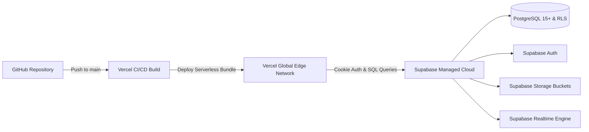

# SocialSentinel: Production Deployment Guide (Vercel & Supabase)

**Deployment Target:** Vercel (Frontend & Serverless Engine) + Supabase Cloud (PostgreSQL, Auth, Storage, Realtime)  
**Target Environment:** Production Ready  

---

## 1. Architecture & Deployment Overview

SocialSentinel is configured for zero-friction continuous deployment:
- **Frontend & Serverless Application:** Deployed on **Vercel** with automatic branch previews and edge routing.
- **Data & Auth Tier:** Hosted on **Supabase** with managed PostgreSQL, Row Level Security, S3-compatible Storage, and Realtime WebSockets.
- **Machine Learning Layer:** Runs directly within Next.js serverless functions with zero cold-start delay using our native TypeScript NLP & recommendation engine. (The legacy Python Flask service remains available as an optional standalone service).



---

## 2. Environment Variables Configuration

Create a `.env.local` file for local development or configure these variables in the **Vercel Dashboard -> Project Settings -> Environment Variables**:

```ini
# ==============================================================================
# Supabase Configuration (Required)
# ==============================================================================
# The public HTTPS URL of your Supabase project (from Settings -> API)
NEXT_PUBLIC_SUPABASE_URL=https://your-project-id.supabase.co

# The public anonymous API key (safe for browser exposure, protected by RLS)
NEXT_PUBLIC_SUPABASE_ANON_KEY=eyJhbGciOiJIUzI1NiIsInR5cCI6IkpXVCJ9...

# The private service-role key (SERVER-ONLY. DO NOT EXPOSE TO BROWSER)
# Used only by seed scripts and administrative maintenance operations.
SUPABASE_SERVICE_ROLE_KEY=eyJhbGciOiJIUzI1NiIsInR5cCI6IkpXVCJ9...

# ==============================================================================
# Application URL Settings
# ==============================================================================
# Canonical public application URL for auth redirects and email links
NEXT_PUBLIC_SITE_URL=https://socialsentinel.vercel.app

# ==============================================================================
# Optional Machine Learning Service (Leave empty to use native engine)
# ==============================================================================
# If running an external Python inference microservice
PYTHON_INFERENCE_SERVICE_URL=
```

> [!IMPORTANT]
> Never prefix `SUPABASE_SERVICE_ROLE_KEY` with `NEXT_PUBLIC_`. It bypasses Row Level Security and must only be accessed in secure server-side scripts or trusted API routes.

---

## 3. Supabase Setup Instructions (Step-by-Step)

### Step 1: Create a New Supabase Project
1. Log in to [Supabase](https://supabase.com) and click **"New Project"**.
2. Set the project name to `SocialSentinel`, generate a strong database password, and select your preferred region.
3. Once provisioned, navigate to **Project Settings -> API** and copy:
   - `Project URL`
   - `Project API keys -> anon (public)`
   - `Project API keys -> service_role (secret)`

### Step 2: Execute SQL Migrations
1. Open the **SQL Editor** in your Supabase dashboard.
2. Open the migration file: `supabase/migrations/20261015000000_init_socialsentinel.sql`.
3. Paste the contents into the SQL Editor and click **"Run"**.
4. This script sets up:
   - All relational tables (`profiles`, `posts`, `comments`, `likes`, `bookmarks`, `follows`, `conversations`, `messages`, `communities`, `reports`, `moderation_actions`).
   - Trigger functions for real-time counters and automatic profile provisioning upon `auth.users` signup.
   - Row Level Security (RLS) policies for every table.
   - Database indexes for query acceleration.

### Step 3: Configure Storage Buckets
1. In the Supabase dashboard, navigate to **Storage -> Buckets**.
2. Click **"New Bucket"**:
   - Bucket name: `avatars` (Public bucket: **Enabled**).
   - Bucket name: `post-media` (Public bucket: **Enabled**).
3. Apply storage policies (included in the migration script) allowing authenticated users to upload files and all users to read public files.

### Step 4: Configure Authentication Redirects
1. Go to **Authentication -> URL Configuration**.
2. In **Site URL**, enter your production URL: `https://your-app.vercel.app`.
3. In **Redirect URLs**, add:
   - `http://localhost:3000/**`
   - `https://your-app.vercel.app/**`
   - `https://your-app.vercel.app/auth/callback`

---

## 4. Database Seeding Instructions

To populate the database with realistic synthetic accounts, posts, topics, comments, communities, and conversations:

```bash
# Set your environment variables in .env.local
NEXT_PUBLIC_SUPABASE_URL=https://your-project.supabase.co
SUPABASE_SERVICE_ROLE_KEY=your-service-role-key

# Run the idempotent seed script
npm run db:seed
```

The deterministic seed script populates:
- **Demo Explorer Account:** `demo@socialsentinel.io` / `Demo1234!` (or instant 1-click login).
- **35 Diverse Creators:** AI researchers, cybersecurity analysts, web engineers, generative artists, digital wellness advocates.
- **120+ Posts:** High-signal posts with sentiment scores, hashtags, and topic assignments.
- **250+ Comments & Replies:** Context-aware discussions.
- **5 Communities:** Pre-configured topic hubs with active memberships.

---

## 5. Vercel Deployment Instructions

### Deploy via Vercel CLI
```bash
# 1. Install Vercel CLI
npm install -g vercel

# 2. Link project
vercel link

# 3. Pull environment variables or configure via dashboard
vercel env pull .env.local

# 4. Deploy to production
vercel --prod
```

### Deploy via GitHub Integration
1. Push your repository to GitHub.
2. In the [Vercel Dashboard](https://vercel.com/new), click **"Add New..." -> "Project"**.
3. Import your `SocialSentinel` repository.
4. Set the Framework Preset to **Next.js**.
5. Add the environment variables:
   - `NEXT_PUBLIC_SUPABASE_URL`
   - `NEXT_PUBLIC_SUPABASE_ANON_KEY`
   - `SUPABASE_SERVICE_ROLE_KEY`
   - `NEXT_PUBLIC_SITE_URL`
6. Click **"Deploy"**.

---

## 6. Health & Readiness Verification

Once deployed, verify the system health:

- **Health Check Probe:**
  ```bash
  curl https://your-app.vercel.app/api/health
  ```
  Expected Response (`200 OK`):
  ```json
  {
    "status": "ok",
    "service": "SocialSentinel",
    "version": "5.0.0",
    "timestamp": "2026-10-15T00:00:00.000Z",
    "database": "connected"
  }
  ```

---

## 7. Deployment Troubleshooting Guide

| Issue / Error | Root Cause | Solution |
| :--- | :--- | :--- |
| **`AuthApiError: Invalid login credentials`** | User account does not exist or password mismatch. | Run `npm run db:seed` or use the 1-click Demo Explorer button. |
| **`new row violates row-level security policy`** | Mutation attempted without an authenticated session or violating RLS. | Ensure `@supabase/ssr` cookies are passed in Server Actions; verify the acting user is the owner. |
| **`JWSError: JWT expired`** | Auth cookie expired. | Next.js middleware automatically calls `supabase.auth.getUser()` to refresh expired sessions; verify middleware is registered in `middleware.ts`. |
| **Image Upload 403 Forbidden** | Storage bucket missing or RLS policy absent. | Create `post-media` and `avatars` buckets in Supabase Storage with public read enabled. |
| **CORS errors on API calls** | Requesting from an unauthorized domain. | Supabase handles CORS for configured Site URLs; verify `NEXT_PUBLIC_SITE_URL` matches your Vercel deployment domain. |
| **N+1 Query Slowdowns** | Using client-side nested fetching. | Use Server Components with JOINed relational queries (e.g. `.select('*, profiles(*), comments(*)')`). |
