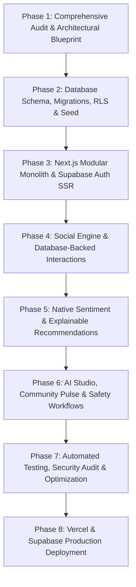

# SocialSentinel: Production Migration Plan & Roadmap

**Target Architecture:** Next.js App Router (TypeScript) + Supabase PostgreSQL  
**Execution Strategy:** Non-destructive, incremental migration preserving working assets  

---

## 1. Migration Strategy & Phase Overview

To ensure zero downtime, preservation of working functionality, and absolute data integrity, the transformation follows an 8-phase execution plan:

---

## 2. Phase-by-Phase Execution Details

### Phase 1: Audit and Blueprint (Current Phase)
- **Objectives:**
  - Inspect backend, frontend, models, and data directory.
  - Run existing test suites (`pytest`) and build pipelines (`npm run build`).
  - Document all architectural flaws, security vulnerabilities, and model limitations.
- **Deliverables:**
  - `docs/architecture.md`
  - `docs/current-state-audit.md`
  - `docs/migration-plan.md`
  - `docs/security.md`
  - `docs/deployment.md`

---

### Phase 2: Database Schema, SQL Migrations, RLS & Seed Data
- **Objectives:**
  - Design a normalized, production-grade PostgreSQL schema in `supabase/migrations/`.
  - Migrate all integer identifiers to UUIDs compatible with `auth.users(id)`.
  - Establish denormalized counters maintained by atomic PostgreSQL trigger functions (eliminating the N+1 query problem).
  - Write granular Row Level Security (RLS) policies for every table (`profiles`, `posts`, `comments`, `likes`, `bookmarks`, `follows`, `conversations`, `messages`, `communities`, `reports`).
  - Create a deterministic, idempotent TypeScript/SQL seed script that populates:
    - 35 realistic synthetic profiles with bios and unique handles.
    - 120+ topic-diverse posts with real sentiment classifications.
    - 250+ threaded comments and replies.
    - Realistic like, follow, and bookmark distributions.
    - 5 topic communities with active memberships.
    - Sample direct conversations and notifications for the demo account.
- **Verification Check:** Execute migration script against PostgreSQL; verify all tables, foreign keys, triggers, and RLS policies activate without errors.

---

### Phase 3: Next.js Modular Monolith & Supabase Auth SSR
- **Objectives:**
  - Initialize Next.js 14/15 App Router with TypeScript (`strict: true`), Tailwind CSS, and Lucide icons.
  - Configure `@supabase/ssr` server client, browser client, action client, and session refresh middleware.
  - Implement secure HTTP-only cookie authentication:
    - Sign up with Zod validation.
    - Sign in and instant 1-click **Sentinel Explorer** demo authentication.
    - Sign out and session revocation.
    - Protected route guards via Next.js middleware.
    - Dark and light theme engine using CSS custom properties.
- **Verification Check:** Test session persistence across page refreshes; verify that no tokens appear in `localStorage`.

---

### Phase 4: Social Engine & Database-Backed Interactions
- **Objectives:**
  - Implement Server Actions and Client Components for:
    - **Posts:** Rich composer with character count, sentiment tone preview, topic selection, image attachment, and ownership checks.
    - **Feed Streams:** Following feed, latest chronological feed, and topic filters with cursor pagination.
    - **Interactions:** Atomic like/unlike, bookmark/unbookmark, reposts, with optimistic UI updates.
    - **Threaded Comments:** Top-level comments and nested replies backed by `parent_comment_id`.
    - **Profiles & Social Graph:** User profile page with follower/following tabs, edit profile modal, follow/unfollow buttons.
    - **Direct Messaging:** Conversation thread list, one-to-one real-time chat, and "Share to Chat" modal.
- **Verification Check:** Every action persists in PostgreSQL; reload page to confirm state matches database records.

---

### Phase 5: Native Sentiment Analysis & Explainable Recommendations
- **Objectives:**
  - Build a high-performance, native TypeScript sentiment engine:
    - Tokenization and stopword removal matching Scikit-Learn TF-IDF preprocessing.
    - Lexicon-enhanced polarity analysis returning `Positive`, `Neutral`, and `Negative` with confidence probabilities.
    - Emotion detection engine classifying text into `joy`, `curiosity`, `wonder`, `inspiration`, `empathy`, `concern`, and `sadness`.
  - Implement the multi-signal hybrid recommendation engine:
    - Signal blending: content cosine similarity, topic alignment, creator affinity, follow graph, freshness half-life decay, and engagement volume.
    - User-adjustable Healthy Feed slider (`exploration_rate`).
    - Explainable rationale badges (e.g., `Based on your #AI interest`, `Following creator`).
    - Serendipity radar feed surfacing novel topics outside echo chambers.
- **Verification Check:** Unit test ranking and sentiment predictions with sample inputs; verify deterministic outputs.

---

### Phase 6: AI Studio, Community Pulse & Safety Workflows
- **Objectives:**
  - **Sentinel AI Studio:**
    - Live interactive NLP sentiment playground with tone preview and probability bars.
    - Real-time sentiment distribution charts across the network.
    - Topic engagement velocity analysis.
  - **Community Pulse:**
    - Aggregated discussion insights and mood radar for each community.
    - Group privacy safeguards (minimum participation thresholds to prevent individual profiling).
  - **Moderation & Safety:**
    - Report modal for posts, comments, and accounts.
    - Moderator review queue with actions (dismiss, warn, remove post, ban user).
    - Block and mute user preferences with automatic feed exclusion.
- **Verification Check:** Test filing a report, logging in as moderator to resolve the report, and verifying blocked users are hidden from feeds.

---

### Phase 7: Automated Testing, Security Audit & Optimization
- **Objectives:**
  - Implement automated Vitest unit tests for:
    - Auth guards and session handling.
    - RLS policy simulation and ownership verification.
    - Like/unlike idempotency.
    - Threaded comment hierarchy.
    - Recommendation score calculation and diversity capping.
    - Sentiment and emotion tokenization.
  - Query optimization: verify index usage on `(author_id, created_at)`, `(user_id, post_id)`, and `(topic_category)`.
  - Fix any type errors, build warnings, and lint issues.
- **Verification Check:** `npm run test` and `npm run build` pass cleanly.

---

### Phase 8: Vercel & Supabase Deployment Preparation
- **Objectives:**
  - Configure `next.config.js` for optimal Vercel serverless deployment.
  - Verify `.env.example` contains clear placeholders without real secrets.
  - Document step-by-step Supabase project setup, SQL migration execution, and Vercel environment variables.
  - Add `/api/health` readiness probe.
- **Deliverables:**
  - Production-ready codebase ready for deployment to Vercel in 1 click.
  - Comprehensive troubleshooting guide in `docs/deployment.md`.
