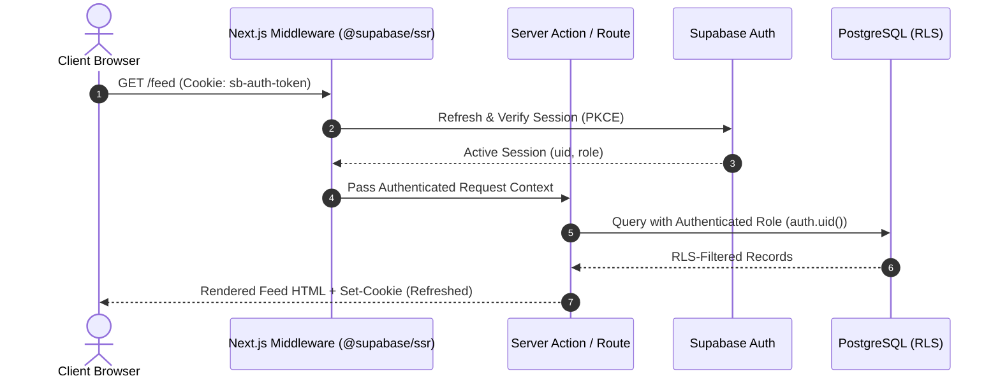

# SocialSentinel: Production Security & Compliance Architecture

**Status:** Security Baseline Specification  
**Scope:** Authentication, Row Level Security (RLS), Authorization, Data Protection, and Threat Modeling  

---

## 1. Threat Model & Security Posture

SocialSentinel handles user identity, public and private social interactions, direct messaging, and content moderation. The application adheres to the principle of **Least Privilege** and **Zero Trust Architecture**:
1. **The Client is Untrusted:** Any parameter passed from the browser (e.g. `user_id`, `is_moderator`) is treated as untrusted input. Authorization is verified exclusively server-side via cryptographic session tokens and PostgreSQL RLS.
2. **Database-Level Enforcement:** Security boundaries are enforced in the database engine via PostgreSQL Row Level Security (RLS), preventing data leaks even in the event of an application logic defect.
3. **No Secret Leaks:** Supabase service-role keys, database passwords, and private environment variables are strictly forbidden from browser bundles.

---

## 2. Authentication & Session Architecture

### 2.1 Transition from `localStorage` to Secure Cookies
The legacy implementation stored JWTs in browser `localStorage`, exposing access tokens to Cross-Site Scripting (XSS) extraction.

The production architecture employs `@supabase/ssr` with **HTTP-Only, Secure, SameSite Cookies**:
- `httpOnly: true`: Prevents client-side JavaScript (and any injected XSS payload) from reading auth cookies.
- `secure: true`: Ensures cookies are transmitted solely over HTTPS in production.
- `sameSite: 'lax'`: Mitigates Cross-Site Request Forgery (CSRF) while supporting standard top-level navigation.
- `path: '/'`: Applies across all application routes.



---

## 3. Row Level Security (RLS) Policy Specifications

Every exposed PostgreSQL table in the `public` schema has Row Level Security enabled (`ALTER TABLE ... ENABLE ROW LEVEL SECURITY;`).

### 3.1 Profiles (`profiles`)
- **SELECT:** Public for active accounts. Blocked users cannot view the blocker's profile.
  ```sql
  CREATE POLICY "Public profiles are viewable by everyone" 
  ON public.profiles FOR SELECT 
  USING (true);
  ```
- **UPDATE:** Users may only update their own profile (`auth.uid() = id`).
  ```sql
  CREATE POLICY "Users can update their own profile" 
  ON public.profiles FOR UPDATE 
  USING (auth.uid() = id)
  WITH CHECK (auth.uid() = id);
  ```
- **INSERT:** Handled exclusively via a PostgreSQL trigger on `auth.users` upon signup.

### 3.2 Posts (`posts`)
- **SELECT:** Readable if author has not blocked the viewer and viewer has not blocked the author.
  ```sql
  CREATE POLICY "Posts readable by unblocked users" 
  ON public.posts FOR SELECT 
  USING (
    auth.uid() IS NULL 
    OR NOT EXISTS (
      SELECT 1 FROM public.blocked_users 
      WHERE (blocker_id = posts.author_id AND blocked_id = auth.uid())
         OR (blocker_id = auth.uid() AND blocked_id = posts.author_id)
    )
  );
  ```
- **INSERT:** Authenticated users may insert posts where `author_id = auth.uid()`.
- **UPDATE / DELETE:** Author only (`auth.uid() = author_id`), or a user with `is_moderator = true`.

### 3.3 Direct Messages (`messages`) & Conversations (`conversations`)
- **SELECT:** Accessible only to users who are members of the conversation in `conversation_members`.
  ```sql
  CREATE POLICY "Messages viewable by conversation members only" 
  ON public.messages FOR SELECT 
  USING (
    EXISTS (
      SELECT 1 FROM public.conversation_members 
      WHERE conversation_id = messages.conversation_id 
        AND user_id = auth.uid()
    )
  );
  ```
- **INSERT:** A user can only insert messages into a conversation they belong to, with `sender_id = auth.uid()`.

### 3.4 Notifications (`notifications`)
- **SELECT / UPDATE:** Visible and modifiable only by the recipient (`user_id = auth.uid()`).
  ```sql
  CREATE POLICY "Notifications viewable only by recipient" 
  ON public.notifications FOR SELECT 
  USING (user_id = auth.uid());
  ```

### 3.5 Moderation & Reports (`reports` & `moderation_actions`)
- **INSERT (Reports):** Any authenticated user can submit a report (`reporter_id = auth.uid()`).
- **SELECT / UPDATE (Reports):** Only users with `is_moderator = true` on their profile, or the original reporter for their own filed reports.
- **Moderation Actions:** Read and insert restricted strictly to verified moderators.

---

## 4. Input Validation & Content Sanitization

1. **Schema Validation via Zod:**
   - Every Server Action and API Route validates incoming payloads before database execution.
   - Example Post validation:
     ```typescript
     export const PostCreateSchema = z.object({
       caption: z.string().trim().min(1, 'Post cannot be empty').max(5000, 'Post exceeds 5,000 characters'),
       topic: z.string().trim().max(80).default('General'),
       media_url: z.string().url().optional().nullable(),
       hashtags: z.string().max(500).optional().default('')
     });
     ```
2. **XSS Protection:**
   - React handles output encoding by default, escaping raw HTML entities.
   - Rich text inputs are stored as plain text with explicit Markdown/plain rendering, avoiding `dangerouslySetInnerHTML`.
3. **File Upload Security:**
   - Supabase Storage bucket `post-media` enforces:
     - Allowed MIME types: `image/jpeg`, `image/png`, `image/webp`, `image/gif`.
     - File size limit: 5 MB maximum per image.
     - Storage RLS: Users can only upload into their own folder `user_id/*`.

---

## 5. Rate Limiting & Anti-Abuse Strategies

1. **Authentication Throttling:**
   - Supabase Auth natively throttles failed password attempts and email sending.
2. **Mutation Throttling in Server Actions:**
   - Timestamp check on user's last post: prevents automated post spamming within a 5-second window.
   - Duplicate interaction protection: Database uniqueness constraints (`UNIQUE (user_id, post_id)` on `likes` and `bookmarks`) reject double-clicks and replay attacks idempotently.
3. **Blocking & Muting Engine:**
   - Muted creators are filtered out of feeds and notifications client/server side.
   - Blocked users are completely prevented from viewing profiles, reading posts, sending messages, or commenting.

---

## 6. Secure Logging & Secrets Management

1. **No Sensitive Data in Logs:**
   - Server-side logging sanitizes headers, masking `Authorization` headers, `cookie` headers, passwords, and message bodies.
2. **Environment Variable Separation:**
   - `NEXT_PUBLIC_SUPABASE_URL`: Safe for browser exposure.
   - `NEXT_PUBLIC_SUPABASE_ANON_KEY`: Safe for browser exposure (strictly constrained by RLS).
   - `SUPABASE_SERVICE_ROLE_KEY`: **Private to trusted server environment.** Never prefixed with `NEXT_PUBLIC_` and never imported into client components.
